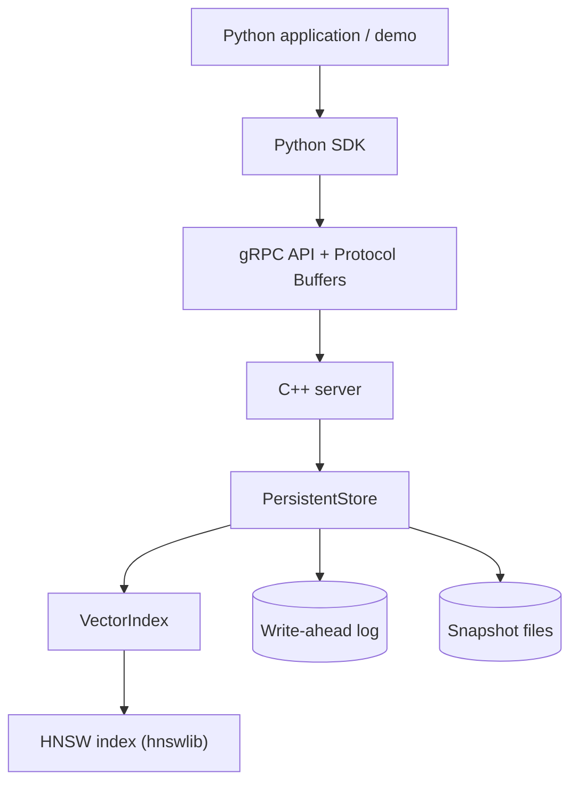

# VectorDB

A lightweight vector database built in C++ with HNSW approximate nearest-neighbor search, WAL-based persistence, metadata filtering, a gRPC API, and a Python SDK.

The project demonstrates how a vector search service can be built from its indexing and storage layers through to a client-facing API, with automated tests and reproducible benchmarks.

[](https://github.com/shubhgupta-dev/VectorDB/actions/workflows/ci.yml)

## Features

- **Approximate nearest-neighbor search:** HNSW indexing using [hnswlib](https://github.com/nmslib/hnswlib).
- **Multiple distance metrics:** cosine similarity, L2 distance, and inner product.
- **Persistent storage:** write-ahead logging (WAL), snapshot creation, and startup recovery.
- **Metadata filtering:** exact-match filters on string key/value metadata.
- **Batch insertion:** insert multiple vector records through the storage layer and gRPC API.
- **gRPC service:** Protocol Buffers define the API between clients and the C++ server.
- **Python SDK:** insert vectors, run searches, retrieve statistics, and create snapshots.
- **Configurable index:** set vector dimensions, distance metric, and HNSW parameters.
- **Automated testing:** C++ build checks and Python SDK integration tests through GitHub Actions.
- **Benchmarking:** compare HNSW search with brute-force exact search to evaluate recall and latency.

## Architecture



### Request flow

1. A Python application calls the SDK.
2. The SDK serializes requests through the gRPC API.
3. The C++ server validates requests and delegates operations to the persistent store.
4. The store manages records, metadata, the vector index, WAL entries, and snapshots.
5. The HNSW index retrieves approximate nearest neighbors for a query vector.
6. Optional metadata filters are applied to retrieved candidates before results are returned.

## Repository layout

```text
VectorDB/
├── .github/
│   └── workflows/
│       └── ci.yml
├── benchmarks/
│   └── benchmark.cpp
├── examples/
├── include/
│   └── vectordb/
│       ├── persistent_store.hpp
│       └── vector_index.hpp
├── proto/
│   └── vectordb.proto
├── python/
│   └── vectordb/
│       ├── generated/
│       └── ...
├── src/
│   ├── main.cpp
│   ├── server.cpp
│   └── ...
├── tests/
│   ├── test_grpc_client.py
│   └── test_sdk.py
├── third_party/
│   └── hnswlib/
├── demo.py
├── CMakeLists.txt
├── pyproject.toml
└── README.md
```

## Requirements

The project is developed and tested on Linux under WSL2.

- C++ compiler with C++17 support
- CMake
- Git
- gRPC and Protocol Buffers development libraries
- Python 3 and `venv`
- A working Git installation with submodule support

### Install system dependencies

On Debian or Ubuntu:

```bash
sudo apt update

sudo apt install -y \
  build-essential \
  cmake \
  git \
  libgrpc++-dev \
  libprotobuf-dev \
  protobuf-compiler \
  protobuf-compiler-grpc \
  python3 \
  python3-venv \
  python3-pip
```

## Build from source

Clone the repository, including its hnswlib submodule:

```bash
git clone --recurse-submodules \
  https://github.com/shubhgupta-dev/VectorDB.git

cd VectorDB
```

If you cloned without submodules, initialize them:

```bash
git submodule update --init --recursive
```

Configure and build:

```bash
cmake -S . -B build -DCMAKE_BUILD_TYPE=Release
cmake --build build -j2
```

The build produces these main executables:

- `build/vectordb_demo` — standalone C++ storage and recovery demonstration.
- `build/vectordb_server` — gRPC server.
- `build/vectordb_benchmark` — ANN benchmark executable.

Generated C++ Protocol Buffers and gRPC sources are produced automatically by CMake.

## Run the standalone C++ demo

```bash
./build/vectordb_demo
```

This demonstration exercises vector insertion, batch insertion, metadata filtering, WAL recovery, snapshot creation, and recovery from persisted data.

It uses `data/metadata_demo`. Do not run it concurrently with another process that uses the same storage directory.

## Run the gRPC server

The server accepts four optional positional arguments:

```text
vectordb_server [address] [dimension] [metric] [storage_directory]
```

Defaults:

| Setting | Default |
|---|---|
| Address | `127.0.0.1:50051` |
| Vector dimension | `3` |
| Metric | `cosine` |
| Storage directory | `data/server_store` |

Start a default server:

```bash
./build/vectordb_server
```

To start a separate 64-dimensional server:

```bash
./build/vectordb_server \
  127.0.0.1:50052 \
  64 \
  cosine \
  data/server_store_64
```

Supported metric names are `cosine`, `l2`, and `inner_product`.

**Important:** use a separate storage directory for each combination of dimension and metric. Existing persisted data must not be reopened with incompatible index configuration.

The default server binds to localhost and uses insecure gRPC transport. It is intended for local development and demonstrations, not exposure to an untrusted network.

## Python SDK

Create and activate a virtual environment:

```bash
python3 -m venv .venv
source .venv/bin/activate

python -m pip install --upgrade pip
python -m pip install -e .
```

Start the gRPC server in one terminal:

```bash
./build/vectordb_server
```

In another terminal, from the project root:

```bash
source .venv/bin/activate
python demo.py
```

The end-to-end demo connects to the server on `127.0.0.1:50053`. Start a dedicated demo server for it:

```bash
./build/vectordb_server \
  127.0.0.1:50053 \
  3 \
  cosine \
  data/interview_demo
```

Then run `python demo.py` in the other terminal.

The demo demonstrates:

- Inserting individual vectors and batches.
- Finding similar vectors.
- Filtering search results by metadata.
- Retrieving index statistics.
- Creating a snapshot.

The sample dataset uses fruit and vegetable vectors for an easy-to-understand demonstration. These are synthetic examples, not a real-world embedding evaluation.

### Python SDK example

```python
from vectordb import VectorDBClient

with VectorDBClient("127.0.0.1:50051") as client:
    client.insert(
        vector_id=1001,
        vector=[1.0, 0.0, 0.0],
        metadata={"category": "fruit", "name": "apple"},
    )

    results = client.search(
        query=[0.98, 0.02, 0.0],
        k=3,
        metadata_filter={"category": "fruit"},
    )

    for result in results:
        print(result)
```

This example assumes a fresh server using the default 3-dimensional cosine configuration. The demo uses fixed IDs, so run it against a clean demo store if you need to reproduce the initial output exactly.

## Testing

### Python SDK integration tests

Start the default server in one terminal:

```bash
./build/vectordb_server
```

Run the test suite in another terminal:

```bash
source .venv/bin/activate
python -m pytest tests/test_sdk.py -v
```

The suite covers insertion, batch insertion, filtered search, statistics, snapshots, invalid search parameters, and client lifecycle behavior.

### Standalone gRPC smoke test

With the server running:

```bash
PYTHONPATH="$PWD/python/vectordb/generated" \
  python tests/test_grpc_client.py
```

### Continuous integration

GitHub Actions runs on pushes, pull requests, and manual workflow dispatches. It checks out the repository and submodules, installs system dependencies, builds the C++ targets, runs the standalone demo, and runs the Python SDK integration tests.

See the [CI workflow](.github/workflows/ci.yml) for the exact steps.

## ANN benchmark

The benchmark compares HNSW search with brute-force exact search on a reproducible synthetic dataset.

It reports:

- Recall@10 against brute-force ground truth.
- HNSW query latency percentiles.
- Build time.
- Effective serial HNSW query throughput.

Example invocation:

```bash
./build/vectordb_benchmark 5000 500 64 100
```

Arguments are:

```text
vectordb_benchmark [vector_count] [query_count] [dimension] [ef_search] [csv_path]
```

An optional CSV path can be supplied as the fifth argument.

### Example results

The following measurements were obtained on a workload of 5,000 vectors, 64 dimensions, and 500 queries, with `k=10`, `M=16`, and `ef_construction=100`. The table reports the median of three repeated runs for each `ef_search` setting.

| `ef_search` | Recall@10 | p50 latency | p95 latency | p99 latency | Effective serial QPS |
|---:|---:|---:|---:|---:|---:|
| 25 | 67.58% | 0.0204 ms | 0.042694 ms | 0.056384 ms | 40,021.5 |
| 50 | 85.16% | 0.05331 ms | 0.143113 ms | 0.216085 ms | 15,412.3 |
| 100 | 95.82% | 0.05513 ms | 0.086895 ms | 0.129178 ms | 16,631.8 |
| 200 | 99.60% | 0.100255 ms | 0.167275 ms | 0.414624 ms | 8,495.23 |

These results illustrate the trade-off between search quality and latency: increasing `ef_search` generally improves recall but can require more search work.

The latency and throughput figures are workload- and machine-dependent. In particular, these measurements are from a small synthetic benchmark and should not be interpreted as production capacity claims. The QPS figure is derived from serial HNSW query timings; it is not end-to-end gRPC throughput.

## Current limitations

This is an interview-oriented educational project, not a production-ready vector database.

- **Approximate search:** HNSW trades exactness for speed; recall depends on index parameters and the dataset.
- **Metadata filtering:** exact-match filtering is performed after candidate retrieval, so selective filters can return fewer than `k` results even when more matching records exist.
- **Persistence durability:** WAL writes are flushed through the stream, but the implementation does not provide a full `fsync`-based power-loss durability guarantee.
- **Batch semantics:** batch insertion delegates to individual insertions and is not an atomic transaction.
- **WAL maintenance:** snapshot creation does not compact or truncate the WAL.
- **Concurrency:** the current index operations use locking for correctness, which can limit parallel throughput.
- **Networking:** the server uses insecure gRPC transport and is intended for local demonstrations.
- **Scope:** the implementation does not provide distributed replication, authentication, authorization, a production schema system, or operational monitoring.

These limitations are deliberate scope boundaries for a compact project demonstrating vector indexing, persistence, RPC design, testing, and benchmarking.

## Future improvements

Potential next steps include:

- Atomic batch operations and stronger durability guarantees.
- WAL compaction after successful snapshots.
- Dedicated metadata indexes for efficient filtered search.
- More comprehensive crash-recovery and concurrency tests.
- Secure transport and authentication.
- Larger, real-world benchmark datasets and workload comparisons.

## License

Review the licenses of the project and its dependencies before redistributing them. hnswlib is included as a Git submodule and retains its own license.
